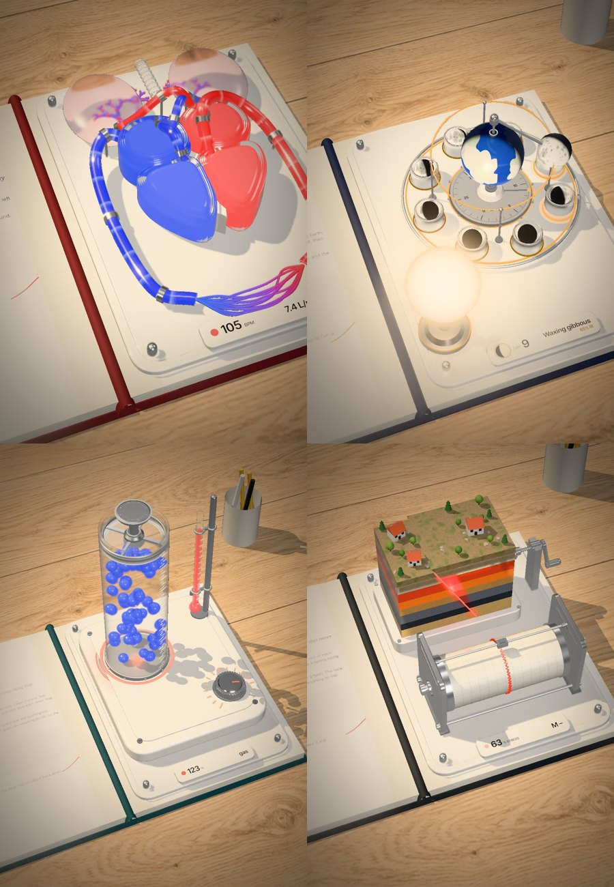

# Glassbook

**Interactive textbooks that open on your desk.** An open hardcover lies on a marble desk in window
light. The left page teaches; out of the right page rises a working glass, ceramic and aluminium
model of the idea, one you can push and play with. Drag across it to change the one thing that
matters (a heart rate, the Moon's orbit, the heat under a cylinder of water), tap it for the one
event (a beat, a whole month, a fault slipping), and watch the live readout follow.



**Try it live: [zerowing.in/glassbook](https://zerowing.in/glassbook)**

Plain three.js and ES modules. No build step, no framework, nothing to install to run it.

## Run it

```sh
git clone https://github.com/MuhammadaliMS/glassbook.git
cd glassbook
python3 -m http.server 8000
```

Open http://localhost:8000 and pick a book. Any static server works (`npx serve`, GitHub Pages).

| Book | Drag sets | Tap does | Readout |
| --- | --- | --- | --- |
| `heart` · Biology: *The double pump* | heart rate, 50–160 bpm | one big beat | `72 bpm · 5.0 L/min` |
| `moon` · Astronomy: *Why the Moon changes shape* | the Moon's place in its orbit | runs a whole month | `day 7 · first quarter · 50% lit` |
| `matter` · Chemistry: *Ice, water, steam* | burner heat, -20 to 140 °C | cools it back to ice | `25 °C · liquid` |
| `quake` · Earth science: *Where earthquakes come from* | winds the crank on a locked fault | forces a slip | `slip! · M 5.1` |

Open a book directly with `book/?s=<name>`, and pick the desk with `&look=marble` (default), `ash`, `studio` or `oak`. Arrow keys drive it too; Space or Enter fires the tap.

## Write a book about anything

A subject is one file in `book/subjects/`. It gives the left page its words and builds the model
on the right page:

```js
export default {
  page: {
    kicker: 'Biology · Lesson 3',
    title: 'The double\npump',
    lede: 'Your heart is two pumps sharing one wall.',
    body: ['The right side…', 'Valves snap shut…'],
    key: 'output = rate × stroke',
    keyNote: '72 beats × 70 mL ≈ 5 L a minute',
    tryIt: 'Drag across the heart to change its pace.',
    caption: 'Fig. 3.1  The double pump',
    pageNo: 42, accent: '#e2392f', cover: '#7a1f24',
  },
  camera: { x: 6.5, y: 0.5, z: 0.8, dist: 60, el: 54, az: -20 },

  async build({ THREE, M, P, curve, slab, smoothShape, roundedRect, flowTexture, root }) {
    // add meshes to `root`; P(x, y, h) is a point on the page (x right, y up the page, h height)
    return {
      u: 0.2,                         // where the control starts, 0..1
      update(dt, t, u) { /* move everything from u and time */ },
      action() { /* the one discrete event */ },
      readout: () => '72 bpm',
    };
  },
};
```

What the engine gives a subject:

- **Materials** `M.glass()`, `M.frosted()`, `M.ceramic()`, `M.alu()`, `M.liquid(color)`: physically
  based, tuned for the desk's light. Glowing liquid is emissive, so the bloom picks it up.
- **Shapes** `smoothShape(points)` makes a smooth closed outline, `slab(shape, depth, bevel)` extrudes
  it up off the page, `roundedRect(w, h, r)`, `curve(points)` for tubes, and `flowTexture(color)`, a
  stripe you scroll along a liquid tube so it reads as flow.
- **The book**: the desk (four looks: marble, ash, studio, oak), the window light with blind shadows, props, the cover, the page text set
  from `page`, the gutter, the opening and the model rising out of the page.
- **Control**: pointer and keyboard drive `u` with a spring; `book.drive(u)`, `book.snap(u)`,
  `book.action()`, `book.pose({ open, rise })` and `book.setCamera({...})` script it from outside.

Everything moves from `requestAnimationFrame` and `performance.now()` only, so a page can be filmed
frame by frame on a virtual clock (see `tools/`).

### With Claude

`skill/glassbook-subject/SKILL.md` is a Claude skill that writes a new subject for you: copy the
folder into `~/.claude/skills/`, then ask *"make a Glassbook page about how a lock and key works"*.

Two other skills pair well with it when you want more than one model per page:
[Anatomy](https://github.com/wheresryan22/anatomy) (explains an idea by building it as a real,
working isometric machine) and [Hairline](https://github.com/lucasmarkes/hairline) (line figures
that answer the pointer).

## Tools

```sh
npm i                                                         # playwright-core, for the tools only
node tools/look.mjs heart docs/heart.jpg --u=0.6              # a still, headless
node tools/capture.mjs heart --seconds=6 --out=heart.mp4      # frame-exact video (needs ffmpeg)
```

## Credits

Inspired by [Every Joule](https://iamtechartist.github.io/every-joule-lesson1/) by Techartist, a
physics textbook you can play with. Built with [three.js](https://threejs.org). MIT licence.
